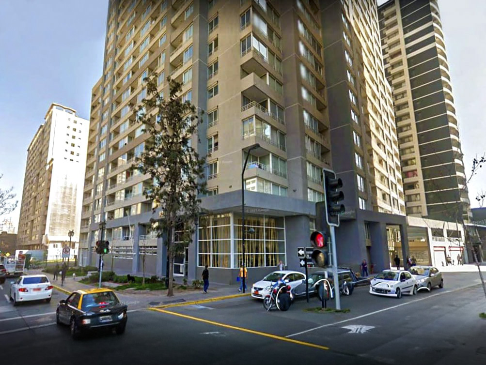

<div align="center">



# 🏢 Edificio Altamira

### Portal Vecinos · Plataforma informativa comunitaria

[](https://react.dev)
[](https://www.typescriptlang.org)
[](https://tailwindcss.com)
[](https://supabase.com)
[](https://www.postgresql.org)
[](https://vitejs.dev)
[](https://vercel.com)
[](LICENSE)

**Plataforma exclusiva y privada para la comunidad del Edificio Altamira.**  
Gestión de elecciones de administración, noticias, documentos oficiales y comunicación entre vecinos.

[🌐 Demo](https://altamira-platform.vercel.app) · [📖 Documentación](#-características) · [🐛 Reportar Bug](issues) · [✨ Solicitar Función](issues)

</div>

---

## 📋 Tabla de Contenidos

- [Sobre el Proyecto](#-sobre-el-proyecto)
- [Características](#-características)
- [Stack Tecnológico](#-stack-tecnológico)
- [Arquitectura](#-arquitectura)
- [Estructura del Proyecto](#-estructura-del-proyecto)
- [Instalación](#-instalación)
- [Variables de Entorno](#-variables-de-entorno)
- [Base de Datos](#-base-de-datos)
- [Scripts Disponibles](#-scripts-disponibles)
- [Roles y Permisos](#-roles-y-permisos)
- [Despliegue](#-despliegue)
- [Seguridad](#-seguridad)
- [Roadmap](#-roadmap)
- [Licencia](#-licencia)

---

## 🎯 Sobre el Proyecto

**Edificio Altamira Portal** es una plataforma web privada diseñada exclusivamente para los vecinos de la comunidad. Centraliza la información clave del edificio y facilita la participación en procesos democráticos como la **elección de la nueva administración**.

### Problema que resuelve

- ❌ Información dispersa en grupos de WhatsApp y correos.
- ❌ Dificultad para acceder a documentos oficiales (reglamentos, actas).
- ❌ Falta de transparencia en procesos electorales.
- ❌ Sin canal formal para conocer candidaturas.

### Nuestra solución

- ✅ Portal único, seguro y exclusivo para vecinos autenticados.
- ✅ Módulo informativo de elecciones con resúmenes y PDFs de cada candidatura.
- ✅ Repositorio centralizado de documentos oficiales.
- ✅ Panel administrativo para gestión de contenido.

> ⚠️ **Importante:** El sitio es **100% informativo**. No permite votaciones digitales; estas son presenciales según reglamento comunitario.

---

## ✨ Características

### 👥 Para Vecinos

| Módulo | Descripción |
|---|---|
| 🗳️ **Elecciones** | Portada principal con candidaturas, resúmenes ejecutivos y propuestas de servicios en PDF |
| 📰 **Noticias** | Comunicados oficiales de la administración en tiempo real |
| 📄 **Documentos** | Reglamentos, actas, informes financieros con vista previa integrada |
| 📞 **Contacto** | Teléfonos, emails, WhatsApp comunitario y contactos de emergencia |
| 📱 **PWA** | Instalable como app nativa en Android e iOS |
| 🌙 **Responsive** | Diseño adaptativo para móvil, tablet y desktop |

### 🔐 Para Administradores

| Módulo | Descripción |
|---|---|
| 📊 **Dashboard** | Métricas en tiempo real del contenido publicado |
| 🗳️ **Candidaturas** | CRUD de administraciones participantes + subida de PDFs |
| 📰 **Noticias** | Publicación, edición y eliminación de noticias |
| 📄 **Documentos** | Gestión con categorías e imágenes de portada personalizadas |
| 📞 **Contacto** | Edición centralizada de datos de contacto de la comunidad |
| 🔒 **Multi-rol** | Sistema de roles con RLS a nivel de base de datos |

---

## 🛠 Stack Tecnológico

<div align="center">

| Frontend | Backend | Infraestructura |
|:---:|:---:|:---:|
| <br>**React 18** | <br>**Supabase** | <br>**Vercel** |
| <br>**TypeScript 5** | <br>**PostgreSQL** | <br>**Vite** |
| <br>**Tailwind CSS v4** | <br>**Supabase Auth** | <br>**Git** |

</div>

### Detalle por capa

#### 🎨 Frontend
- **React 18** — UI declarativa con hooks
- **TypeScript 5** — Tipado estricto end-to-end
- **Tailwind CSS 4** — Utilidades + `@theme` para tokens de diseño
- **React Router 6** — Routing SPA con rutas protegidas
- **react-pdf 9** — Visor de PDFs integrado con worker vía CDN

#### 🔐 Backend (BaaS)
- **Supabase Auth** — Autenticación con credencial compartida + usuario admin
- **Supabase Database** — PostgreSQL 15 con RLS
- **Supabase Storage** — Bucket privado `pdfs` con URLs firmadas

#### 🚀 DevOps
- **Vite 5** — Build ultrarrápido (HMR instantáneo)
- **Vercel** — CI/CD con deploy automático desde GitHub
- **PWA** — Service Worker + manifest para instalación móvil

---

## 🏗 Arquitectura
┌─────────────────────────────────────────────────────────┐
│ NAVEGADOR (Vecino/Admin) │
│ ┌────────────────────────────────────────────────────┐ │
│ │ React SPA (Vite + TypeScript + Tailwind) │ │
│ │ ┌──────────────┐ ┌───────────────┐ │ │
│ │ │ Área Vecino │ │ Panel Admin │ │ │
│ │ │ /elecciones │ │ /admin/* │ │ │
│ │ │ /noticias │ │ │ │ │
│ │ │ /documentos │ │ CRUD total │ │ │
│ │ │ /contacto │ │ │ │ │
│ │ └──────────────┘ └───────────────┘ │ │
│ └────────────────────────────────────────────────────┘ │
└────────────────────────────┬────────────────────────────┘
│ HTTPS (JWT)
▼
┌─────────────────────────────────────────────────────────┐
│ SUPABASE (Backend as a Service) │
│ ┌──────────────┐ ┌──────────────┐ ┌──────────────┐ │
│ │ Auth │ │ PostgreSQL │ │ Storage │ │
│ │ Credencial │ │ con RLS │ │ bucket pdfs │ │
│ │ compartida │ │ │ │ (privado) │ │
│ └──────────────┘ └──────────────┘ └──────────────┘ │
└─────────────────────────────────────────────────────────┘
│
▼
┌────────────────┐
│ VERCEL CDN │
│ Deploy auto │
└────────────────┘

### Flujo de datos

1. El vecino ingresa con la **credencial compartida** → Supabase Auth emite un JWT.
2. El JWT se adjunta automáticamente a cada petición a Supabase.
3. Las **políticas RLS** verifican el rol del usuario en `user_roles` antes de permitir cualquier operación.
4. Los PDFs se sirven con **URLs firmadas** que expiran en 1 hora (bucket privado).

---

## 📁 Estructura del Proyecto
altamira-platform/
│
├── 📂 public/ # Assets estáticos
│ ├── edificio-altamira.jpg # Foto del edificio (login + logo)
│ ├── og-image.jpg # Imagen Open Graph (1200×630)
│ ├── icon-192.png # PWA icon pequeño
│ ├── icon-512.png # PWA icon grande
│ ├── icon-maskable-512.png # PWA icon adaptive (Android)
│ ├── apple-touch-icon.png # iOS icon (180×180)
│ └── manifest.webmanifest # Configuración PWA
│
├── 📂 sql/ # Scripts de base de datos
│ ├── schema.sql # Tablas base + RLS de lectura
│ └── admin_schema.sql # Roles admin + políticas de escritura
│
├── 📂 src/
│ │
│ ├── 📂 components/ # Componentes reutilizables
│ │ ├── 📂 admin/ # Componentes exclusivos del admin
│ │ │ ├── AdminLayout.tsx # Sidebar + layout del panel
│ │ │ ├── AdminRoute.tsx # Guard de rutas con rol admin
│ │ │ ├── FileUpload.tsx # Subida PDF/imagen con preview
│ │ │ └── Modal.tsx # Modal reutilizable
│ │ ├── Footer.tsx # Pie de página
│ │ ├── InstallPWA.tsx # Banner de instalación PWA
│ │ ├── Layout.tsx # Layout del sitio público
│ │ ├── Loading.tsx # Spinner de carga
│ │ ├── Navbar.tsx # Navegación con drawer móvil
│ │ ├── PdfViewer.tsx # Visor de PDFs con react-pdf
│ │ └── ProtectedRoute.tsx # Guard de rutas autenticadas
│ │
│ ├── 📂 context/
│ │ └── AuthContext.tsx # Session + isAdmin + signIn/out
│ │
│ ├── 📂 hooks/ # Custom hooks de datos
│ │ ├── useAdminAdministrations.ts # CRUD candidaturas (admin)
│ │ ├── useAdminContactInfo.ts # Update contacto (admin)
│ │ ├── useAdminDocuments.ts # CRUD documentos (admin)
│ │ ├── useAdminNews.ts # CRUD noticias (admin)
│ │ ├── useAdministrations.ts # Listado candidaturas (vecino)
│ │ ├── useContactInfo.ts # Lectura contacto (vecino)
│ │ ├── useDocuments.ts # Listado documentos (vecino)
│ │ └── useNews.ts # Noticias + detalle (vecino)
│ │
│ ├── 📂 lib/
│ │ └── supabase.ts # Cliente de Supabase
│ │
│ ├── 📂 pages/ # Páginas de la aplicación
│ │ ├── 📂 admin/ # Páginas del panel admin
│ │ │ ├── AdminAdministrations.tsx
│ │ │ ├── AdminContact.tsx
│ │ │ ├── AdminDashboard.tsx
│ │ │ ├── AdminDocuments.tsx
│ │ │ └── AdminNews.tsx
│ │ ├── Contact.tsx # Página de contacto
│ │ ├── Documents.tsx # Repositorio de documentos
│ │ ├── Elections.tsx # 🏠 Portada principal
│ │ ├── Login.tsx # Autenticación
│ │ ├── News.tsx # Listado de noticias
│ │ └── NewsDetail.tsx # Detalle de noticia
│ │
│ ├── 📂 types/
│ │ └── index.ts # Tipos TypeScript globales
│ │
│ ├── 📂 utils/
│ │ └── storage.ts # Upload/delete/resolve URLs firmadas
│ │
│ ├── App.tsx # Router principal
│ ├── main.tsx # Entry point
│ ├── index.css # Tailwind + tokens @theme
│ └── vite-env.d.ts # Tipos de Vite env
│
├── 📄 .env.example # Template de variables de entorno
├── 📄 .gitignore
├── 📄 index.html # HTML raíz con SEO + PWA
├── 📄 package.json
├── 📄 tsconfig.json
├── 📄 vite.config.ts
├── 📄 vercel.json # Headers para PWA
└── 📄 README.md # Este archivo

### Convenciones de nombres

| Tipo | Convención | Ejemplo |
|---|---|---|
| Componentes | `PascalCase.tsx` | `PdfViewer.tsx` |
| Hooks | `useCamelCase.ts` | `useDocuments.ts` |
| Páginas | `PascalCase.tsx` | `Elections.tsx` |
| Tipos/Interfaces | `PascalCase` | `Administration` |
| Variables/funciones | `camelCase` | `handleViewPdf` |
| Constantes | `SCREAMING_SNAKE` | `CATEGORY_META` |

---

## 🚀 Instalación

### Requisitos previos

[](https://nodejs.org)
[](https://www.npmjs.com)

### Pasos

```bash
# 1. Clonar el repositorio
git clone https://github.com/TU-USUARIO/altamira-platform.git
cd altamira-platform

# 2. Instalar dependencias
npm install

# 3. Copiar el template de variables de entorno
cp .env.example .env.local

# 4. Editar .env.local con tus credenciales de Supabase
# (ver sección "Variables de Entorno")

# 5. Ejecutar los scripts SQL en Supabase
# (ver sección "Base de Datos")

# 6. Colocar la foto del edificio en public/
# public/edificio-altamira.jpg

# 7. Iniciar el servidor de desarrollo
npm run dev
Esquema de tablas
administrations    -- Candidaturas con resumen + PDF
├── id (UUID, PK)
├── name (TEXT)
├── summary (TEXT)
├── full_description (TEXT)
├── pdf_url (TEXT)
├── contact_name (TEXT)
├── order_index (INT)
└── created_at (TIMESTAMPTZ)

news               -- Noticias y avisos
├── id (UUID, PK)
├── title (TEXT)
├── content (TEXT)
├── image_url (TEXT)
└── published_at (TIMESTAMPTZ)

documents          -- Reglamentos, actas, etc.
├── id (UUID, PK)
├── title (TEXT)
├── description (TEXT)
├── category (TEXT)
├── file_url (TEXT)
├── cover_image_url (TEXT)
└── uploaded_at (TIMESTAMPTZ)

contact_info       -- Singleton (id=1)
├── id (INT, PK, CHECK id=1)
├── admin_phone (TEXT)
├── admin_email (TEXT)
├── admin_hours (TEXT)
├── address (TEXT)
├── whatsapp_url (TEXT)
├── conserjeria_phone (TEXT)
├── conserjeria_hours (TEXT)
├── emergencies_note (TEXT)
└── updated_at (TIMESTAMPTZ)

user_roles         -- Roles de usuario
├── user_id (UUID, PK, FK auth.users)
├── role (TEXT: 'vecino' | 'admin')
└── created_at (TIMESTAMPTZ)
🔒 Seguridad
Este proyecto implementa defensa en profundidad con múltiples capas:

1. Autenticación
Supabase Auth con JWT firmados

Credencial compartida para vecinos + usuario admin separado

2. Autorización (RLS)
Row Level Security habilitado en todas las tablas

Políticas SELECT para authenticated

Políticas INSERT/UPDATE/DELETE solo si user_roles.role = 'admin'

3. Storage
Bucket pdfs privado (nunca público)

URLs firmadas con expiración de 1 hora

Solo admin puede subir/eliminar

4. Frontend
ProtectedRoute — requiere sesión

AdminRoute — requiere rol admin

Sin claves sensibles en el bundle (anon_key solo, nunca service_role)

5. SEO
noindex, nofollow — el portal no aparece en Google

🗺 Roadmap
✅ Completado
☑ Autenticación con credencial compartida
☑ Módulo de elecciones con PDFs y resúmenes
☑ Noticias con detalle
☑ Documentos con categorías y portadas
☑ Panel admin con CRUD completo
☑ Contacto editable desde admin
☑ PWA instalable (Android + iOS)
☑ SEO + Open Graph para redes sociales
☑ Diseño responsive con drawer móvil
🚧 En desarrollo
□ Notificaciones push para nuevas noticias
□ Historial de auditoría de cambios del admin
□ Mapa embebido con ubicación del edificio
□ Búsqueda global en documentos
💡 Ideas futuras
□ Reserva de áreas comunes (quincho, sala de eventos)
□ Registro de visitas
□ Foro vecinal moderado
□ Estado de cuenta individual por unidad
□ Chat interno entre vecinos
🤝 Contribuciones
Este es un proyecto privado y exclusivo del Edificio Altamira.
No acepta contribuciones externas. Para mejoras internas, contacta al administrador del sistema.